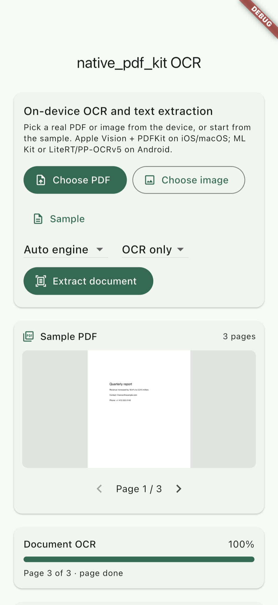
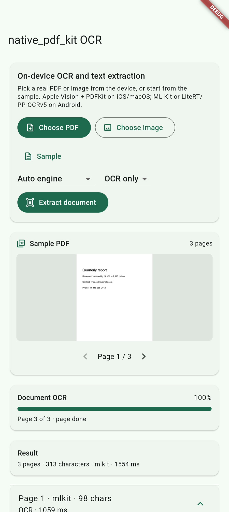
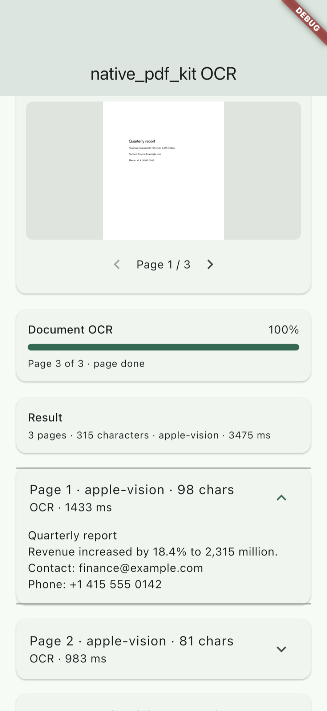
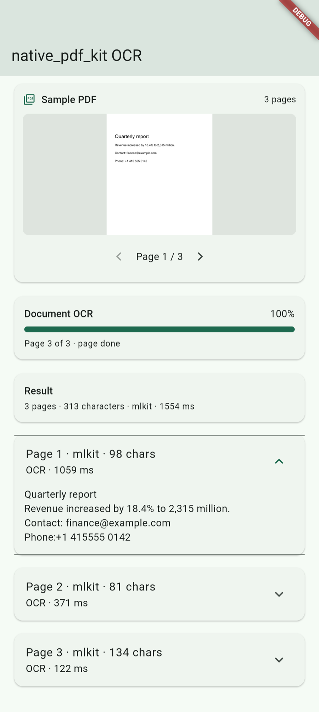

# native_pdf_kit

Fast, dependency-free **native PDF rendering, imaging, optimization and page
operations** for Flutter, built on direct interop — no platform channels, no
bundled third-party PDF engine.

- **iOS / macOS**: CoreGraphics for PDF pages, ImageIO for JPEG/PNG encoding.
- **Android**: JNIgen over the platform's `PdfRenderer`, `Bitmap` and
  `BitmapFactory`.
- **Optimizer, text extraction and page edits**: our own pure-Dart PDF
  parser/writer, shared by every platform.
- **OCR**: opt-in companion package [`native_pdf_kit_ocr`](packages/native_pdf_kit_ocr)
  (Apple Vision + PDFKit, Android ML Kit or LiteRT/PP-OCRv5).

Everything in the core package is our own code calling OS APIs. There is no
third-party source, so the only copyright notice is ours.

Published: [`native_pdf_kit` 0.3.2](https://pub.dev/packages/native_pdf_kit) ·
OCR: [`native_pdf_kit_ocr` 0.1.2](https://pub.dev/packages/native_pdf_kit_ocr).

## Screenshots

The example app picks a **real PDF or image** from the device, previews it,
runs OCR with live progress, and shows the extracted text.

| iOS — Apple Vision | Android — ML Kit |
| --- | --- |
|  |  |
|  |  |

## Why

Platform channels serialize every call and force async plumbing. Rendering a
PDF page or re-encoding an image is a bulk-data job: direct FFI passes bytes
without a serialization round trip, and the system codecs are the fastest and
highest-quality option on the platform. The parser and writer are pure Dart so
optimization, text extraction, merging and page edits work identically on
every target.

## Device support

- **iOS 13+** (iPhone 6s and later) and **macOS 10.15+**.
- **Android 5.0+ (API 21)**, including arm64-v8a, armeabi-v7a and x86_64.
- No hardware-specific APIs: rendering uses the platform PDF stack, imaging
  uses the platform codecs.

## Install

```yaml
dependencies:
  native_pdf_kit: ^0.3.2
```

For OCR add the companion:

```yaml
dependencies:
  native_pdf_kit_ocr: ^0.1.2
```

## Usage

```dart
import 'package:native_pdf_kit/native_pdf_kit.dart';

final document = NativePdfDocument.open('/path/file.pdf');
print(document.pageCount);
print(document.pageSize(0)); // 595.0 × 842.0 pt

final jpeg = document.renderPage(0, width: 1240);
final png = document.renderPage(
  0,
  width: 1240,
  format: NativeImageFormat.png,
);
```

Compress an image with the native codecs:

```dart
final result = NativeImageCompressor.compress(
  bytes,
  maxDimension: 2048,
  quality: 82,
  format: NativeImageFormat.jpeg,
);
```

### Optimization

```dart
final report = NativePdfOptimizer.optimize(
  bytes,
  reduceImages: true,        // false for strict lossless
  maxImageDimension: 2480,   // ~300 DPI for A4
  jpegQuality: 85,
);
if (report.changed) save(report.bytes);
```

The optimizer understands classic xref tables, **xref streams, hybrid files
and `/ObjStm` object streams**, follows incremental-update `/Prev` chains, and
applies PNG/TIFF predictors. It drops unreachable objects, recompresses Flate
streams at level 9, downsamples `DCTDecode` JPEGs, and converts 8-bit
DeviceRGB/DeviceGray **Flate images to JPEG**. It re-parses its own output,
compares page counts, and returns the input unchanged for anything it cannot
handle safely (encryption, JPX/CCITT/JBIG2, masks, CMYK, palettes).

### Text and page edits

```dart
final text = PdfTextExtractor.extract(bytes);
final pages = PdfTextExtractor.extractPages(bytes); // per page, one parse

final rotated = PdfPageEditor.rotate(bytes, degrees: 90);
final reordered = reorderPdfPages(bytes, [2, 0]);   // also split/remove
final merged = mergePdfs([first, second]);          // append documents

final meta = PdfMetadataEditor.read(bytes);
final withMeta = PdfMetadataEditor.write(
  bytes,
  PdfMetadata(title: 'GRN scan', author: 'Eishal Cyril'),
);
```

The pure-Dart text extractor reads `Tj`/`TJ` from Flate or uncompressed
content streams and now handles predictors. It ignores CMaps, so simple
standard-font documents work best. Scanned pages have no text layer — use the
OCR companion, which can fall back to OCR page by page.

### OCR with realtime progress

```dart
final document = NativePdfDocument.open('/path/scan.pdf');

await for (final event in NativePdfOcr.recognizeDocument(document)) {
  switch (event) {
    case PdfOcrProgress():
      print('${(event.overallProgress * 100).round()}% ${event.stage}');
    case PdfOcrPageEvent():
      print(event.page.text);
    case PdfOcrDoneEvent():
      print(event.document.text);
  }
}
```

`native_pdf_kit_ocr` uses Apple Vision + PDFKit on Apple platforms and ML Kit
Text Recognition v2 (bundled) on Android, with an optional LiteRT + PP-OCRv5
engine. It reports per-page and intra-page progress, supports cancellation and
returns normalized line boxes. See the [companion README](packages/native_pdf_kit_ocr/README.md)
for the licensing and Android setup decisions.

## Capabilities

```dart
NativePdfCapabilities.isSupported;      // iOS, macOS, Android
NativePdfCapabilities.rendering;        // page count, size, raster
NativePdfCapabilities.imageCompression; // resize + JPEG/PNG
NativePdfCapabilities.optimization;     // parser/writer
NativePdfCapabilities.textExtraction;   // best-effort text layer
NativePdfCapabilities.pageEditing;      // rotate/reorder/remove/split
NativePdfCapabilities.merge;            // cross-document merge
NativePdfCapabilities.metadata;         // document info dictionary
```

Unsupported features fail with an explicit exception rather than silently
doing nothing.

## Performance notes

- Rendering and encoding happen in the system stacks, in C, with no Dart-side
  image decode.
- The rendering API is synchronous; call it from a background isolate for large
  pages so the UI thread stays free.
- Page images are returned as freshly allocated bytes; no native handles are
  retained, so there is nothing to leak.
- Rendering honours the PDF page rotation and fills transparency with white,
  which is what OCR and document previews expect.
- The OCR companion polls a native worker; progress does not require a platform
  channel and does not block the UI isolate.

## Running the tests

`flutter test` runs on the Dart VM, which does not link CocoaPods/SPM sources
into the test process. Build the test dylib first:

```sh
./tool/build_native_test_lib.sh
flutter test
```

The example app runs the same code on a device or simulator:

```sh
cd example
flutter run
```

The OCR companion has its own test suite:

```sh
cd packages/native_pdf_kit_ocr
./tool/build_native_test_lib.sh
flutter test
```

Device tests (ML Kit, LiteRT and Vision) live in the example:

```sh
cd example
flutter test integration_test/ocr_test.dart -d <device-id>
```

## Android notes

Android has no public PDF-writing API, so the optimizer, text extraction,
merge and page edits are pure Dart and work on every target. Rendering, page
size and image encoding use `PdfRenderer`/`Bitmap` through generated JNIgen
bindings. `textExtraction`, `pageEditing`, `merge`, `optimization` and
`metadata` are available on Android.

Regenerate the Android bindings after changing the class list:

```sh
dart run tool/jnigen.dart
```

That needs a JDK 17–21 and the Android SDK (`ANDROID_HOME`).

## Not in 0.3.0

- **Signing** and **encryption**: security-critical; they need vetted crypto and
  an audit rather than a home-grown implementation. Encrypted PDFs are returned
  unchanged by the optimizer and cannot be OCRed until decrypted.
- **Lossy recompression of JPX/CCITT/JBIG2/CMYK images** and soft-masked
  images: left untouched for correctness.
- Annotations and form fields.
- OCR is in the companion package, not here.

## License

MIT, Copyright (c) 2026 Eishal Cyril.
